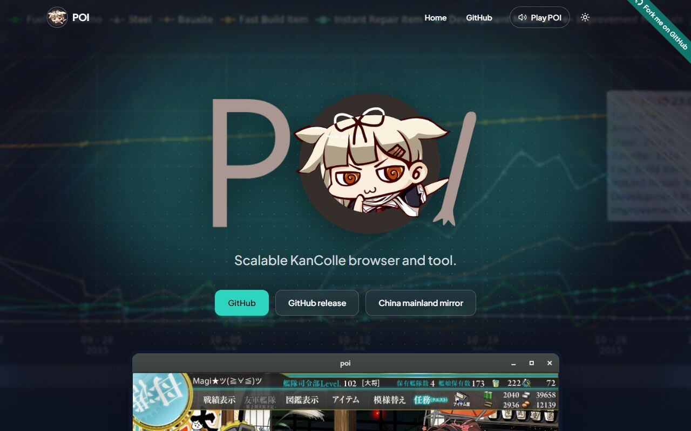
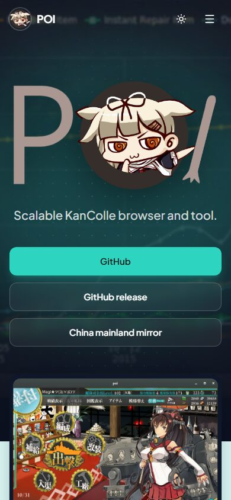
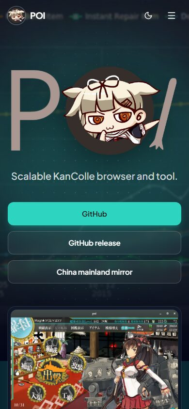
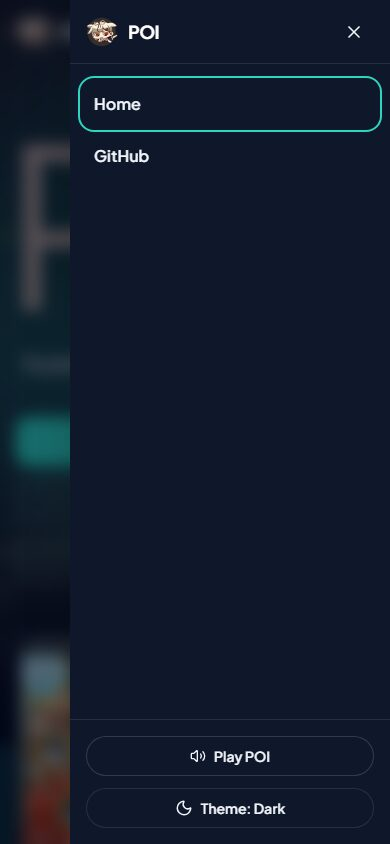
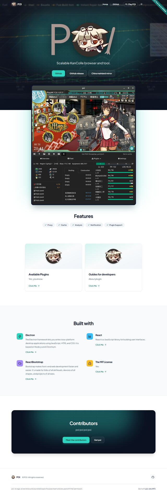
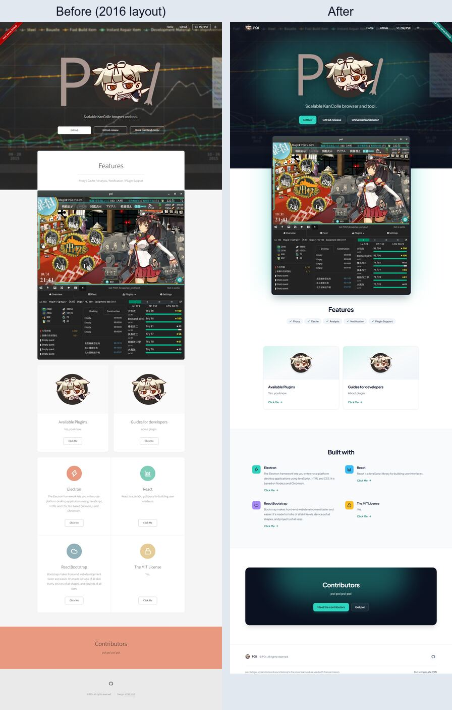
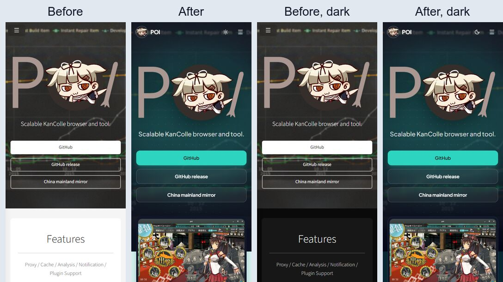

# poi-site

[](https://github.com/NatLee/poi-site/actions/workflows/ci.yml)
[](https://github.com/NatLee/poi-site/actions/workflows/deploy.yml)


[](LICENSE)

A one-page landing site template built with React, TypeScript and Tailwind CSS. Everything a visitor
sees (name, tagline, links, sections, images, colours, even the button sound) lives in **one file**,
[`src/site.config.ts`](src/site.config.ts). Edit it, push, and GitHub Pages publishes your site.
The demo content is a landing page for [poi](https://github.com/poooi/poi), a KanColle browser.

**Live demo:** <https://natlee.github.io/poi-site/>

<picture>
  <source media="(prefers-color-scheme: dark)" srcset="docs/images/desktop-dark.jpg">
  
</picture>

<p>
  
  
  
</p>

<details>
<summary>The whole page</summary>

<picture>
  <source media="(prefers-color-scheme: dark)" srcset="docs/images/full-page-dark.jpg">
  
</picture>

</details>

## What you get

- **One config file.** Typed and commented, so your editor autocompletes it and the build stops on typos.
- **Building blocks you can reorder:** a dark hero with a glow, a framed screenshot that rises out of it,
  clickable cards, a feature list with coloured icon tiles, a call-to-action panel, and a footer.
- **Light, dark and system colour modes**, remembered per visitor, with no white flash on load.
- **Works on phones:** a menu that slides in from the right and closes on Escape, a tap outside, a link
  or a swipe to the right.
- **Small touches:** a pinned header that frosts over once you scroll past the hero, an optional button
  sound, an optional "Fork me on GitHub" ribbon, and readable text and links whatever primary colour you pick.
- **Accessible:** skip link, keyboard-friendly menu, alt text, focus rings, and an automated
  [axe](https://github.com/dequelabs/axe-core) check in the test suite.
- **Deploys itself:** pushing to `gh-pages` (or `main`) builds and publishes to GitHub Pages.

## Quick start

You need [Node.js](https://nodejs.org) 22.13 or newer (24 LTS recommended).

1. Get a copy: click **Use this template** on GitHub, or clone it:

   ```bash
   git clone https://github.com/NatLee/poi-site.git my-site
   cd my-site
   ```

2. Install and start the dev server:

   ```bash
   npm ci
   npm run dev
   ```

   Open the address it prints (<http://localhost:5173/poi-site/>). The page reloads as you save.

3. Open `src/site.config.ts` and start replacing the poi content with yours. The checklist under
   [Swap out the demo content](#swap-out-the-demo-content) lists everything that has to go.

## Make it yours

Put your images, icons and sounds in `public/`, then point the config at them with paths like
`images/banner.png`. The base path for GitHub Pages is added for you.

Change the name, tagline and buttons:

```ts
hero: {
  title: 'Acme Rocket',
  tagline: 'Gets you to orbit before lunch.',
  actions: [
    { label: 'Download', href: 'https://github.com/acme/rocket/releases', variant: 'solid' },
    { label: 'Docs', href: '#features' },
  ],
  background: { image: 'images/launch.jpg', pattern: 'images/texture.svg', color: '#1e1b4b', dim: 0.7 },
},
```

Add a section: drop another entry into `sections`. Icons come from [Lucide](https://lucide.dev/icons);
import the ones you use at the top of the config.

```ts
import { Rocket } from 'lucide-react';

sections: [
  // …
  {
    type: 'features',
    id: 'why',
    title: 'Why Acme',
    items: [
      { title: 'Fast', text: 'Very.', icon: Rocket, action: { label: 'Benchmarks', href: 'https://example.com' } },
    ],
  },
  { type: 'cta', id: 'start', title: 'Ready?', actions: [{ label: 'Get started', href: '#top', variant: 'solid' }] },
],
```

Section types: `showcase`, `cards`, `features` and `cta`. Each `id` becomes an anchor, so `#why` links
scroll to it. To add a new type, add it to the `Section` union in [`src/types.ts`](src/types.ts), write a
component in `src/sections/`, and add a `case` in [`SectionView.tsx`](src/sections/SectionView.tsx).

Other things you can change in the config:

| Setting | What it does |
|---|---|
| `meta` | Tab title, description, favicon, language, and the link-preview image |
| `theme.primary` | Main colour: solid buttons, links, highlights, focus rings, the glow. Button text picks black or white for contrast, and links get a darker shade on white when needed |
| `theme.accents` | Feature icon tile colours, used in turn |
| `hero.background` | Photo, texture tile, dark base colour (also used by the call-to-action panel), how much to darken the photo, and whether it stays still while scrolling |
| `theme.defaultMode`, `theme.toggle` | First-visit colour mode (`system`, `light`, `dark`) and whether to show the switch |
| `nav` | Header links |
| `sound` | The header sound button. Delete it to hide the button |
| `forkRibbon` | The corner ribbon. Delete it to hide the ribbon |
| `footer` | Icon links, copyright, small print (`note`) and a credit link |

Every field is described in [`src/types.ts`](src/types.ts); hover over a field in your editor to see it.
`npm test` also checks the config: it fails when a file is missing from `public/`, an `#anchor` has no
section, or a colour is not a hex value.

The typeface is Plus Jakarta Sans. To change it, swap the `@fontsource-variable/…` import and the
`--font-sans` line in [`src/index.css`](src/index.css).

### Swap out the demo content

The poi name, logo, screenshots and sound are only here as a demo (see [Credits & licenses](#credits--licenses)).
Before you publish your own site, replace or delete:

- [ ] `public/images/banner.png`: hero background photo
- [ ] `public/images/header.png`: hero logo (or remove `hero.logo` to show `hero.title` as text)
- [ ] `public/images/pic01.png`: the big screenshot
- [ ] `public/images/poi.png`: favicon, header logo and card images
- [ ] `public/POI.mp3`: the header sound (or remove `sound`)
- [ ] every text and link in `src/site.config.ts`, including `meta.url`, `forkRibbon` and `footer.note`
- [ ] the screenshots in `docs/images/` and this README

`public/images/texture.svg` (the dot texture) is part of the template, so you can keep it.
`npm test` tells you if the config still points at a file you deleted.

## Commands

| Command | What it does |
|---|---|
| `npm run dev` | Dev server with live reload |
| `npm test` | Tests: config checks, page behaviour, accessibility |
| `npm run lint` | ESLint |
| `npm run typecheck` | TypeScript, no output files |
| `npm run build` | Type-check, then build the site into `dist/` |
| `npm run preview` | Serve `dist/` locally to try the production build |
| `npm run check` | Lint, type-check, test and build in one go |

## Deploy to GitHub Pages

1. Push your copy to GitHub.
2. In the repository, open **Settings → Pages** and set **Source** to **GitHub Actions**.
3. Push to `gh-pages` or `main`. The [deploy workflow](.github/workflows/deploy.yml) lints, tests,
   builds and publishes. The site appears at `https://<you>.github.io/<repo>/`.

The workflow reads the right base path from GitHub, so a copy named `my-site` is served from `/my-site/`
and a `<you>.github.io` repository or a custom domain from `/`, without editing anything.

To build for another host, set `BASE_PATH` yourself:

```bash
BASE_PATH=/ npm run build        # site at the root of a domain
BASE_PATH=/docs/ npm run build   # site under /docs/
```

In Git Bash on Windows, put `MSYS_NO_PATHCONV=1` in front, or Git Bash rewrites `/` into a Windows path.

## Project layout

```text
.
├── public/               # Images and sounds used by the config, copied as-is
├── src/
│   ├── site.config.ts    # ← all the content: edit this
│   ├── types.ts          # What each config field means
│   ├── sections/         # Hero, Showcase, CardGrid, FeatureGrid, CallToAction, Footer
│   ├── components/       # Header, MobileMenu, buttons, links, colour-mode switch, …
│   ├── hooks/            # Colour mode, sound, "scrolled past the hero"
│   └── lib/              # Small helpers (paths, colours, <head> tags, brand icons)
├── docs/images/          # Screenshots for this README
├── index.html            # Page shell; <head> is filled in from the config at build time
├── LICENSE               # MIT, for the code (not the poi images and sound)
└── .github/workflows/    # CI for pull requests, deploy to Pages
```

## History

This started in 2016 as a static page built from a free HTML template, with jQuery and Font Awesome.
In 2026 it was rebuilt as this React + Tailwind template with a design of its own; every section, link,
image, the sound and the header and menu behaviour were carried over. The old static version is in the
git history (commit `86338c8`).

<details>
<summary>Before and after the redesign</summary>





</details>

## Credits & licenses

- **Code** (everything outside `public/` and `docs/images/`, plus `public/images/texture.svg`):
  [MIT](LICENSE). Use it for anything, keep the copyright notice.
- **poi content**: the poi name, logo, screenshots and sound (`public/images/banner.png`, `header.png`,
  `pic01.png`, `poi.png`, `public/POI.mp3`, and the screenshots in `docs/images/`) belong to the
  [poooi](https://github.com/poooi) team and are used here with their permission. They are **not** covered
  by the MIT license. If you reuse the template, replace them with your own
  (see [Swap out the demo content](#swap-out-the-demo-content)).
- Icons: [Lucide](https://lucide.dev) (ISC). GitHub mark from [Simple Icons](https://simpleicons.org) (CC0).
- Font: [Plus Jakarta Sans](https://github.com/tokotype/PlusJakartaSans) (SIL Open Font License), via Fontsource.
